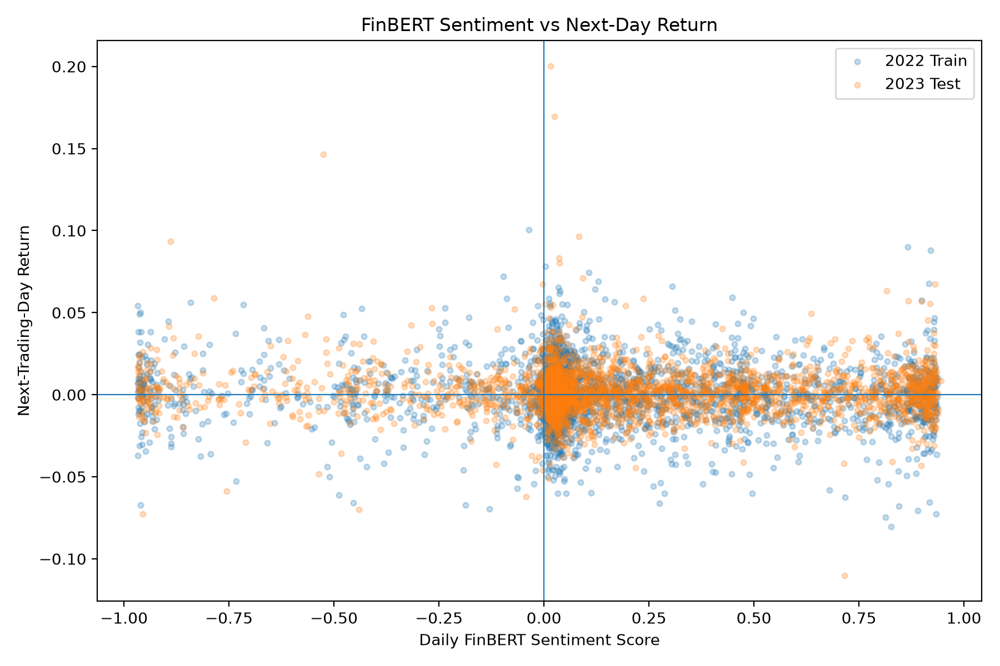
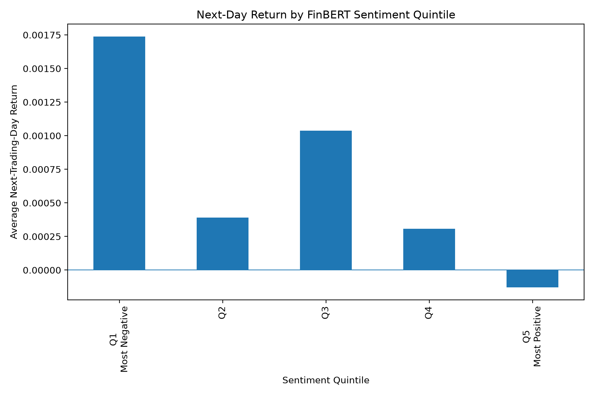
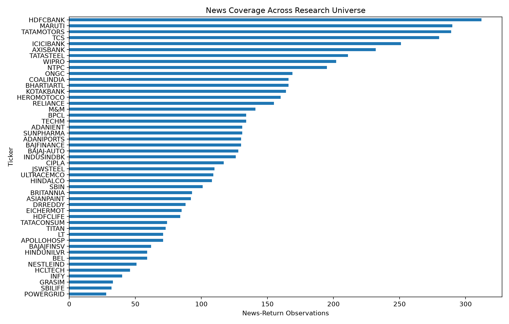

<<<<<<< HEAD
# Stock Market Prediction Dashboard

## An Explainable Indian Equity Growth Outlook System

> **Current dashboard status:** The running app currently retrieves recent financial news and analyzes article sentiment with FinBERT. The equity growth outlook, valuation assessment, and risk classification are still in development. The historical backtest findings below describe a separate research experiment; they are not live forecasts.

> **Can financial-news sentiment predict stock returns?**

An empirical **Financial NLP + Quantitative Research** project that investigates whether sentiment extracted from financial news using **FinBERT** contains predictive information about subsequent stock returns.

The project builds a complete research pipeline from raw financial-news archives to sentiment generation, stock-level aggregation, trading-session alignment, forward-return construction, statistical testing, and chronological out-of-sample evaluation.

### Key Result

A statistically significant negative relationship between FinBERT sentiment and subsequent returns appears in the **2022 training period**, but the relationship **does not persist in the 2023 out-of-sample period**.

This suggests that the observed in-sample relationship does not provide sufficient evidence of stable predictive power.

---

## Research Question

> **Does financial news sentiment contain statistically significant and stable information about future stock returns?**

Instead of optimizing a trading strategy for historical performance, this project focuses on determining whether a sentiment signal can **generalize to unseen market data**.

The analysis evaluates:

- 1-trading-day forward returns
- 5-trading-day forward returns
- Pearson correlation
- Spearman rank correlation
- OLS regression
- HAC / Newey-West standard errors
- Fama–MacBeth cross-sectional regressions
- 5-day momentum as a baseline/control
- Chronological train/test evaluation

---

## Research Pipeline

```text
Economic Times Archives
          │
          ▼
Company / Ticker Matching
          │
          ▼
Stock-linked Headlines
          │
          ▼
FinBERT Sentiment
          │
          ▼
Daily Stock-Level Sentiment
          │
          ▼
Trading-Session Alignment
          │
          ▼
Forward Return Construction
          │
          ▼
Chronological Train / Test Split
          │
          ▼
Statistical & Econometric Analysis
          │
          ▼
Out-of-Sample Evaluation

# Dataset

## News Data

The project uses Economic Times headline archives covering:

- 2022
- 2023
- 2024
- 2025

### Dataset progression

| Stage | Observations |
|---|---:|
| Raw Economic Times headlines | 350,001 |
| Stock-linked news observations | 10,022 |
| Stock × trading-session observations | 6,113 |

The stock-linking pipeline matches headlines against company aliases defined in:

```text
config/universe.py

## Stock Universe

The initial universe contains **50 NIFTY 50 companies**.

After news availability and price-alignment constraints, the final statistical sample contains:

**47 stocks**

Excluded stocks:

- **ITC** — No matched news observations
- **TRENT** — No matched news observations
- **SHRIRAMFIN** — News observations existed, but no usable price alignment for the research period


# Sentiment Modeling

Each financial headline is analyzed using **ProsusAI/FinBERT**.

FinBERT produces probabilities for:

- Positive
- Neutral
- Negative

Instead of reducing the model output to a simple class label, the project retains the probability distribution.

The primary sentiment signal is:

`sentiment_score = positive_probability - negative_probability`

Therefore:

- Positive values → more positive sentiment
- Negative values → more negative sentiment
- Values near zero → relatively neutral sentiment

---

# News Aggregation

Multiple headlines can occur for the same company on the same calendar day.

The pipeline aggregates article-level sentiment into a **stock × trading-session** observation.

The resulting dataset contains:

- Sentiment score
- Positive probability
- Neutral probability
- Negative probability
- Article count
- Ticker
- Trading date
- Forward returns

This produces a cleaner unit of analysis for the statistical tests.


# Trading-Session Alignment

A major concern in financial prediction research is **look-ahead bias**.

News may be published:

- after market hours
- on weekends
- on market holidays

Therefore, the project maps news observations to the **next available trading session**.

The return measurement begins from that subsequent trading session.

This prevents the analysis from accidentally using market information that would not have been available when the news signal was generated.

Multiple calendar dates that map to the same trading session are consolidated so that the same future return is not unintentionally reused.

---

# Forward Returns

For each stock, future returns are calculated from historical closing prices.

### 1-Day Forward Return

`R(t+1) = Close(t+1) / Close(t) - 1`

### 5-Day Forward Return

`R(t+5) = Close(t+5) / Close(t) - 1`

The analysis therefore tests whether sentiment is associated with returns occurring **after the signal**.


# Experimental Design

## Chronological Train/Test Split

The project deliberately avoids random train/test splitting.

Training period: **2022**

Out-of-sample test period: **2023**

This better reflects how a financial signal would actually be evaluated:

> Learn from the past → test on the future.

No random shuffling is used.

---

# Statistical Analysis

The project evaluates the sentiment signal using multiple complementary approaches.

### Correlation

- Pearson correlation
- Spearman rank correlation

### Regression

The primary specification is:

`Forward Return ~ Sentiment Score`

HAC / Newey-West standard errors are used to account for temporal dependence.

### Momentum Control

A 5-day trailing return is also calculated as a momentum feature.

A controlled specification evaluates:

`Forward Return ~ Sentiment Score + 5-Day Momentum`

### Fama–MacBeth

Daily cross-sectional regressions are performed across stocks, and the resulting coefficients are averaged through time.

This provides an additional test of whether sentiment is associated with subsequent cross-sectional stock returns.


# Results

## Primary Regression

| Period | Horizon | N | Coefficient | t-stat | p-value |
|---|---:|---:|---:|---:|---:|
| 2022 Train | 1-Day | 3024 | -0.002445 | -2.820 | 0.0048 |
| 2022 Train | 5-Day | 3024 | -0.005034 | -2.283 | 0.0225 |
| 2023 Test | 1-Day | 3079 | -0.000775 | -1.029 | 0.3035 |
| 2023 Test | 5-Day | 3079 | -0.001821 | -1.086 | 0.2773 |

### Interpretation

The sentiment coefficient is statistically significant during the 2022 training period.

However, the relationship becomes statistically insignificant during the 2023 out-of-sample period.

This is the most important result of the experiment.

---

# Fama–MacBeth Results

| Period | Horizon | Dates | Mean Sentiment Coefficient | t-stat | p-value |
|---|---:|---:|---:|---:|---:|
| 2022 Train | 1-Day | 229 | -0.002653 | -2.340 | 0.0193 |
| 2022 Train | 5-Day | 229 | -0.008777 | -2.922 | 0.0035 |
| 2023 Test | 1-Day | 231 | -0.000049 | -0.062 | 0.9504 |
| 2023 Test | 5-Day | 231 | -0.000389 | -0.201 | 0.8403 |

The Fama–MacBeth analysis produces the same overall conclusion:

**The relationship observed in 2022 does not replicate in 2023.**


# Key Finding

The experiment demonstrates an important distinction between:

**In-sample statistical significance**

and

**Out-of-sample predictive robustness.**

### In 2022

FinBERT sentiment has a statistically significant negative relationship with:

- next-trading-day returns
- 5-trading-day returns

### In 2023

The relationship disappears.

The sentiment coefficients become small and statistically insignificant for both horizons.

Adding recent momentum as a control also does not restore the sentiment relationship in the 2023 test period.

### Conclusion

> **This experiment does not provide sufficient evidence that the tested FinBERT sentiment signal has stable out-of-sample predictive power for stock returns.**

Importantly, this does **not** mean that financial sentiment is useless.

It means that **this particular signal, dataset, period, and methodology did not demonstrate robust predictive power out-of-sample.**


# Visual Analysis

### Sentiment vs Next-Day Return



### Return by Sentiment Quintile



### News Coverage Across Stocks




# Project Structure

```text
stock-market-prediction-dashboard/
│
├── config/
│   └── universe.py
│
├── data/
│   ├── raw/
│   └── processed/
│
├── research/
│   ├── benchmark/
│   ├── datasets/
│   ├── figures/
│   ├── reports/
│   ├── test_aggregator.py
│   └── test_news_filter.py
│
├── src/
│   ├── analytics/
│   │   ├── returns.py
│   │   └── sentiment_aggregation.py
│   │
│   ├── data/
│   │   └── ...
│   │
│   ├── research/
│   │   ├── build_backtest_dataset.py
│   │   ├── run_backtest.py
│   │   ├── robust_analysis.py
│   │   ├── fama_macbeth.py
│   │   └── generate_results.py
│   │
│   └── sentiment/
│       ├── analyzer.py
│       └── model.py
│
├── .gitignore
├── README.md
└── requirements.txt


# Reproducibility

## 1. Clone the repository

    git clone <repository-url>
    cd finbert-sentiment-returns-backtest

## 2. Create a virtual environment

    python3 -m venv .venv

## 3. Activate the environment

    source .venv/bin/activate

## 4. Install dependencies

    python -m pip install -r requirements.txt

## 5. Run the research pipeline

    python -m src.research.build_backtest_dataset

    python -m src.research.run_backtest

    python -m src.research.robust_analysis

    python -m src.research.fama_macbeth

    python -m src.research.generate_results

    python -m src.research.generate_plots

Raw datasets and generated processed datasets are intentionally excluded from version control.


# Limitations

This project is an empirical research experiment and **not a validated trading strategy**.

Important limitations include:

- News coverage is restricted to the available Economic Times archive.
- The model analyzes headlines rather than full article text.
- Company-name matching can produce false positives.
- News coverage is uneven across companies.
- The research0not modeled.
- Liquidity constraints are not modeled.
- Market impact is not modeled.
- The analysis does not establish causality.
- Statistical significance does not imply economic significance.
- The relationship may be regime-dependent.
- Data availability can introduce selection and survivorship effects.


# What This Project Demonstrates

This project demonstrates an end-to-end financial machine-learning research workflow.

### Financial NLP

- FinBERT inference
- Probability-based sentiment scoring
- Financial headline processing

### Data Engineering

- Large-scale news filtering
- Company/entity matching
- Data cleaning
- Stock-level aggregation
- Trading-calendar alignment

### Quantitative Finance

- Forward return construction
- Momentum features
- Event-style analysis
- Cross-sectional analysis

### Statistical Modeling

- Pearson correlation
- Spearman correlation
- OLS regression
- HAC / Newey-West standard errors
- Fama–MacBeth regressions

### Research Methodology

- Look-ahead bias prevention
- Chronological validation
- Out-of-sample testing
- Robustness analysis
- Explicit treatment of data limitations

---

# Final Takeaway

A statistically significant relationship between financial-news sentiment and subsequent stock returns was observed in the 2022 training sample.

However, the relationship failed to replicate in the 2023 out-of-sample period across both tested return horizons.

Therefore:

> **Based on this experiment, there is insufficient evidence that the tested FinBERT sentiment signal provides stable predictive information about future stock returns.**

The negative result is an important part of the research outcome.

Rather than optimizing the methodology until an in-sample relationship looks impressive, this project prioritizes **leakage control, chronological validation, statistical rigor, and honest out-of-sample evaluation.**
=======
# Stock-Market-Prediction-Dashboard
>>>>>>> e432793a94f95c51d121e7ab0fa550e440da720a
